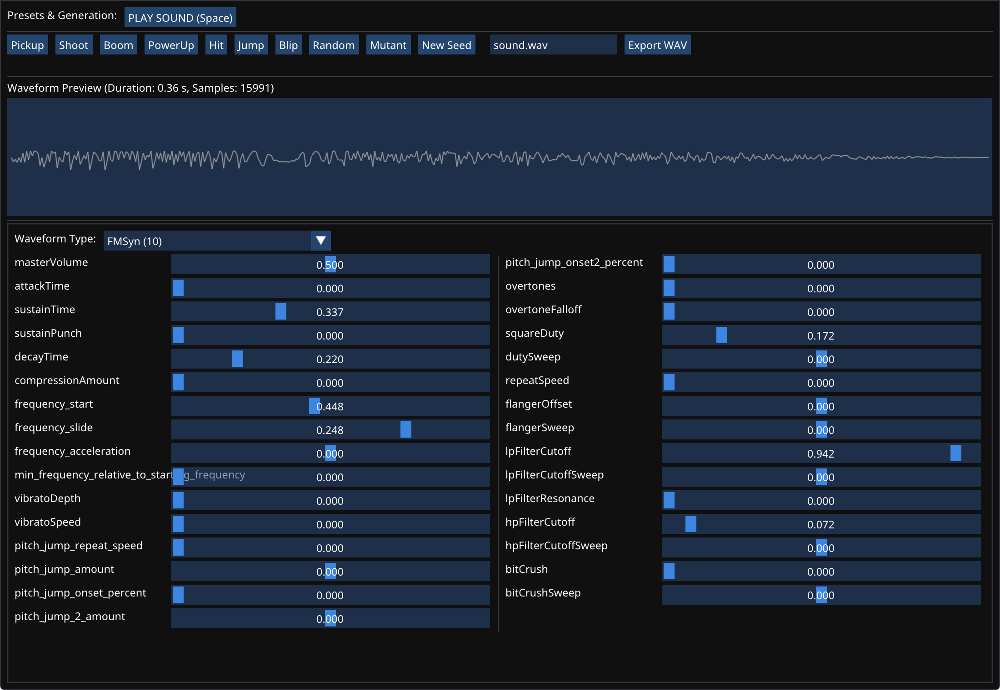

# bfxr2pp

A clean, modern C++17 library port and rework of the [bfxr2](https://github.com/bfxr/bfxr2) sound effect synthesizer engine, designed for straightforward integration into custom game engines and audio toolchains.

## Features

- **Self-contained DSP core**: Full sound generation pipeline ported from bfxr2 (pitch slides, envelopes, flanger, low/high-pass filters, bitcrush, harmonics, vibrato, etc.).
- **Procedural sound presets**: Algorithmic generation for classic game SFX categories (`Pickup/Coin`, `Laser/Shoot`, `Explosion`, `Powerup`, `Hit/Hurt`, `Jump`, `Blip/Select`, `Randomize`, `Mutate`).
- **Flexible parameter reading**: [`IParamReader`](file:///home/camargo/proj/bfxr2pp/include/bfxr2/param_reader.h) interface with optional built-in [`JsonParamReader`](file:///home/camargo/proj/bfxr2pp/include/bfxr2/json_min.h) (can be completely disabled for minimal builds).
- **Adventure Kid Single-Cycle Waveforms (AKWF)**: Embedded lookup tables for rich non-basic waveforms.
- **Deterministic PRNG**: Native Mulberry32 implementation ensuring bit-exact or parity reproducibility with bfxr2 web/JS output.
- **Zero external dependencies**: Clean C++17 with built-in 16-bit PCM WAV exporter.
- **Modern CMake integration**: Standard `find_package(bfxr2 CONFIG)` export, configurable static/shared targets, and clean namespaced includes (`#include <bfxr2/...>`).

## Building & Installation

### Requirements

- CMake 3.15 or newer
- C++17 capable compiler (GCC 8+, Clang 7+, MSVC 2019+)

### Build with CMake

```bash
cmake -B build -DCMAKE_BUILD_TYPE=Release
cmake --build build
```

#### CMake Options

| Option | Default | Description |
|---|---|---|
| `BUILD_SHARED_LIBS` | `OFF` | Build shared library instead of static |
| `BFXR2_ENABLE_JSON` | `ON` | Include built-in JSON parameter parser (`JsonParamReader`) |
| `BFXR2_BUILD_TOOLS` | `ON` | Build CLI rendering tool (`bfxr_render`) |
| `BFXR2_BUILD_EXAMPLES` | `OFF` | Build examples (`bfxr2pp_sdl_play`, `bfxr2pp_gui`) |

### Installing

```bash
cmake --install build --prefix /path/to/install
```

### Integration via CMake

In your project's `CMakeLists.txt`:

```cmake
find_package(bfxr2 CONFIG REQUIRED)

add_executable(my_game main.cpp)
target_link_libraries(my_game PRIVATE bfxr2::bfxr2)
```

Or via `FetchContent` / `add_subdirectory`:

```cmake
add_subdirectory(path/to/bfxr2pp)
target_link_libraries(my_game PRIVATE bfxr2::bfxr2)
```

## Quick Start (C++ API)

### 1. Generating Sounds from Procedural Presets

```cpp
#include <bfxr2/bfxr_dsp.h>
#include <bfxr2/presets.h>
#include <bfxr2/prng.h>
#include <bfxr2/wav.h>

int main() {
    bfxr::Mulberry32 rng(12345);

    // Generate parameters procedurally:
    bfxr::ParamMap laser = bfxr::generate_laser_shoot(rng);
    // Or via category enum:
    // bfxr::ParamMap coin = bfxr::generate_preset(bfxr::PresetCategory::PickupCoin, rng);

    // Render 44.1kHz mono audio samples:
    bfxr::RenderResult result = bfxr::render_bfxr(laser, rng);
    if (result.ok) {
        std::string wav = bfxr::encode_wav16(result.samples.data(), result.samples.size(), 44100);
        bfxr::write_file("laser.wav", wav);
    }
}
```

### 2. Loading Parameters with `IParamReader` / `JsonParamReader`

```cpp
#include <bfxr2/bfxr_dsp.h>
#include <bfxr2/json_min.h>
#include <bfxr2/wav.h>

#include <fstream>
#include <sstream>

int main() {
    std::ifstream file("sound.bfxr");
    std::stringstream buffer;
    buffer << file.rdbuf();

    bfxr::JsonParamReader reader;
    bfxr::ParamMap params;
    std::string err;
    if (!reader.parse(buffer.str(), params, &err)) {
        // Handle error...
        return 1;
    }

    auto result = bfxr::render_bfxr(params, 42 /* seed */);
    // Use result.samples...
}
```

You can also implement your own `bfxr::IParamReader` (for binary formats, SQLite, custom config formats, etc.) without depending on any JSON parsing code.

## CLI Usage

The repository includes `bfxr_render`, a command-line tool to render sound files:

```bash
# Render a preset procedurally by name
./build/bfxr_render --preset shoot --out laser.wav --seed 1
./build/bfxr_render --preset coin --out coin.wav --seed 42

# List all available preset categories
./build/bfxr_render --list-presets

# Render a saved .bfxr file
./build/bfxr_render --in sound.bfxr --out out.wav --seed 1

# Dump supported parameters and schema info as JSON
./build/bfxr_render --dump-info
```

## Examples

### SDL3 Audio Playback (`bfxr2pp_sdl_play`)

When built with `-DBFXR2_BUILD_EXAMPLES=ON`, the project builds `bfxr2pp_sdl_play` under `examples/sdl_playback/`, which generates sound effects procedurally and plays them through SDL3:

```bash
# Build with examples enabled
cmake -B build -DBFXR2_BUILD_EXAMPLES=ON
cmake --build build

# Play a preset with a random or specific seed
./build/bfxr2pp_sdl_play shoot
./build/bfxr2pp_sdl_play coin --seed 42
./build/bfxr2pp_sdl_play explosion

# Show help and all available presets
./build/bfxr2pp_sdl_play --help
```

### Interactive GUI Studio (`bfxr2pp_gui`)

When built with `-DBFXR2_BUILD_EXAMPLES=ON`, the project builds `bfxr2pp_gui` under `examples/gui/`, using Dear ImGui (via CMake FetchContent) and the SDL 2D renderer:



```bash
./build/bfxr2pp_gui
```

Features:
- **Preset Buttons**: Click any preset button (`Pickup`, `Shoot`, `Boom`, `PowerUp`, `Hit`, `Jump`, `Blip`, `Random`, `Mutant`) to procedurally generate a new variation on every click.
- **Interactive Sliders**: Real-time parameter editing for all synthesis properties (frequencies, envelopes, filters, flanger, bitcrush, duties, vibrato).
- **Live Waveform Preview**: Oscilloscope display updating dynamically as parameters are modified.
- **Audio Playback**: Immediate playback via SDL3 audio stream (`Spacebar` or "PLAY SOUND" button).
- **WAV Export**: Save generated sounds directly to 16-bit PCM WAV.
- **HiDPI & System Fonts**: Crisp text rendering scaled to native window pixel density with automatic system font and dark/light theme detection.

## Credits

Essentially all credit goes to the upstream `bfxr2` project, and its contributors. I just adjusted the existing testing tool, already in C++, and adapted it for my needs, porting more JS synths along the way. This version is probably behind on features and since-added synths. Yet it simply fulfills my need for an easily integratable version for my engine.

## License

Licensed under the BSD 3-Clause license, following the original bfxr2 project. See [LICENSE](LICENSE) for details.
